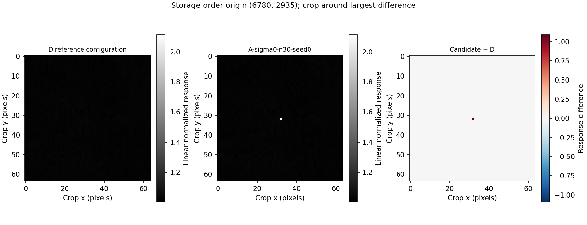
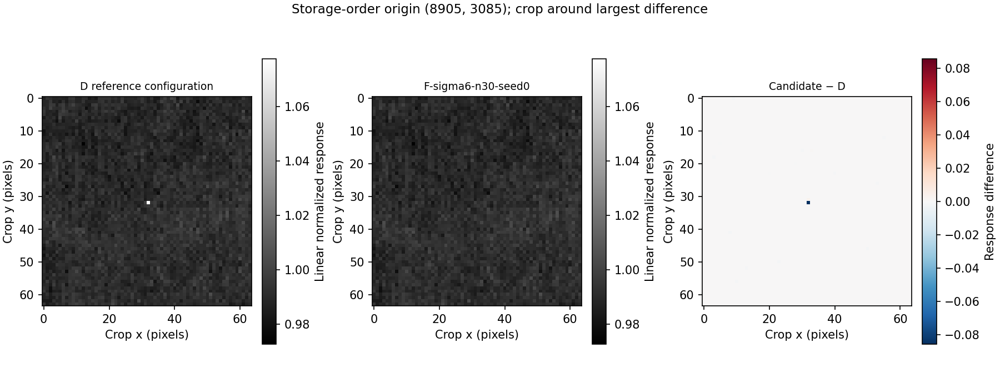
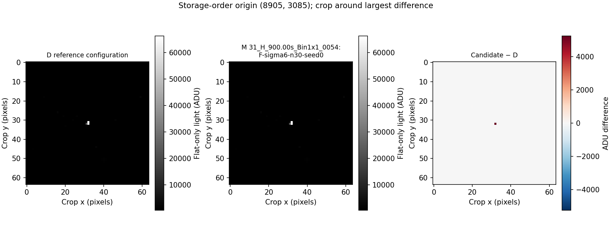

# Flat defect suppression evaluation

This experiment evaluates existing master integration before proposing a new
production preprocessing stage. The original CLI additions exposed existing master suppression. Following the
evaluation, per-frame replacement is now available as an explicitly experimental,
opt-in CLI/core/C ABI/Python setting; default integrations remain unchanged.

## Session results

All 80 full-resolution integrations completed, retaining every requested input
and producing zero fallback pixels. The [numeric summary](benchmarks/flat-defect-sfro-h/summary.md),
[CSV](benchmarks/flat-defect-sfro-h/results.csv), input identities, configurations,
source snapshot and raw JSON measurements are retained alongside this report.
The archived executed source matches the run hash. The current example adds the
later synthetic probe test and calls the shared core filter; its numerical
algorithm is unchanged.
The large FITS masters/masks and sparse per-exposure masks remain in
`/tmp/seiza-flat-evaluation-v2` (about 6 GiB including CLI verification outputs).

The full D master corrected 17,561 channel samples out of 61,171,488 pixels.
Native star masking excluded 112 input samples and changed 105 final pixels
relative to C; it was not numerically identical on the full set. The known
repeated saturated pixel at (6812, 2967) survives temporal rejection alone and
is removed by existing master suppression.

Across all three reduced selections, F6 reduced held-out RMS relative to D by
only 0.009–0.023%; F10 by 0.00025–0.00067%. These are relative changes in the RMS,
not percentage points of normalized sensor response. Full-set F6 differs from
D at 61,152,685 samples, with RMS 0.00007124 response; F10 changes 2,189 samples,
with RMS 0.00001251 response. A local preprocessing change can also alter the
normalization of an entire exposure, so the changed-sample count is not a
count of independently detected defects.

Across three matching raw H lights, flat-only F6 versus D changes the sampled
adjacent-difference noise estimate by a mean −0.000374 ADU (D's mean is
17.4553 ADU); F10 changes it by −0.0000108 ADU. These extremely small changes do
not establish a practically useful improvement. Neither measurement is an
error against truth, and neither removes the need for proper bias/dark
calibration and independent validation.

Observed 30-frame workflow timings on 10 logical CPUs of an Intel i9-14900K
(development profile, opt-level 1) were:

| Configuration | Spatial preprocessing (s) | Integration + correction mask (s) | Combined measured stages (s) |
|---|---:|---:|---:|
| D | 0 | 27.95 | 27.95 |
| F6 | 226.50 | 26.76 | 253.26 |
| F10 | 234.30 | 27.54 | 261.84 |

These are single observed workflow timings, not isolated or replicated
production-algorithm benchmarks. Preprocessing includes cache and diagnostic
I/O. The complete matrix took 29.3 minutes; process-wide peak RSS was about
1,008 MiB. The separate real CLI verification peaked at about 722 MiB. Its
master and correction mask are each byte-for-byte identical to the harness's
D master and mask, and its console/JSON correction counts both equal 17,561.

**Recommendation: keep per-frame spatial replacement experimental.** The small
same-session RMS changes and negligible scene-noise changes do not meet the
required evidence for a production addition. Existing opt-in master suppression
already handles the known persistent bright excursion. This does not rule out
benefits on other small or contaminated datasets.

Representative linear comparisons use shared intensity scales and signed
differences; they are configuration comparisons, not ground-truth error maps:







The initial CLI-only evaluation passed eight CLI integration tests, two
prototype tests, and the 66 existing stacking output-version cases. Its first
broad unit-test build exhausted local resources. The follow-up experimental
integration completed all required checks: workspace/all-feature Rust tests
(with incremental compilation disabled, two jobs, and optimization lowered for
the largest stacking/C ABI test binaries), Rust 1.89 locked checks, workspace
and separate Python Clippy/formatting, and binding parity. The full Python
suite passed 1,645 tests with one skipped. The localhost worker test required
running outside the network sandbox.

Existing output-version fixtures pass unchanged; a new 67th stacking case
checks calibration order and experimental output, and a planted threshold
change made that case fail before restoring the defaults. No existing-mode
pixel output changed, so `OUTPUT_VERSION` is unchanged. A real five-frame H
CLI run matched all 61,171,488 samples of the evaluated F6 master exactly, with
32,071 input replacements and 18,981 finished-master replacements. The
[follow-up report](benchmarks/flat-defect-sfro-h/experimental-cli-report.json)
and [verification](benchmarks/flat-defect-sfro-h/experimental-cli-validation.json)
record this check. The remaining research
gaps include independent calibrated truth, multi-session/filter coverage,
verified background/star-region measurements, and coordinate-level rejection
maps (only actual rejection counts are available through the existing API).

## Reproduce

The implementation starts from `origin/main` at
`c1ab8a1` (Release 0.49.0). Keep original inputs read-only. From the repository:

```sh
cargo run -p seiza-cli --example flat_defect_evaluation -- \
  /tmp/seiza-flat-evaluation-repro \
  /mnt/astro/sfro/2024-09-12-SFRO/FLAT/_H_*.fits
python3 scripts/flat_defect_report.py /tmp/seiza-flat-evaluation-repro
```

Use a new output directory for every run. `--quick` evaluates the complete
30-frame set only. The default also evaluates 5, 10, and 20 frames with three
stable LCG/Fisher–Yates selections each. Filenames are sorted before selection;
`subsets.json` records exact indices into `dataset.json`. Thirty frames permit
only one distinct complete-set selection. Two spatial thresholds mean eight
configurations per selection: A/B/C/D, E6/F6, E10/F10, for 80 integrations.

`--spatial-sigmas 6,10`, `--minimum-relative-excess 0.01`,
`--noise-floor-adu 1`, and `--saturation-level 65535` make the prototype's defaults
explicit and configurable. The explicit saturation ceiling is kept identical
for original integer frames and processed float frames. Adjust it for other
cameras or encodings. The harness deliberately offers no bias/dark arguments
for this session. Production `seiza master flat` still supports both.

All image reads and writes pass through `seiza-image-io`, including those made
by the stacking readers/writers. The current standalone example and the CLI
share the core experimental 5×5 positive-only local median/MAD filter. It excludes the center, uses only
same-CFA-plane neighbors, requires at least 12 finite neighbors, uses a robust
scale of `max(1.4826 * MAD, noise_floor_adu)`, and replaces only when both sigma
and relative excess thresholds are exceeded. It reads original samples for all
decisions, so replacements do not cascade. Negative impulses are intentionally
not repaired by this positive-only prototype. Persistent genuine high response
can still be replaced, which is a central limitation of spatial detection.

A–F all reuse Seiza's normal normalization, temporal rejection (3 sigma low and
high), star masking, and master impulse suppression (16 sigma low and high).
Master correction masks compare samples immediately before/after the existing
core filter; the detector is never rerun just to obtain a mask.

The outputs of this session are retained in `/tmp/seiza-flat-evaluation-v2`;
use a fresh directory for reproduction.

## Dataset

The supplied directory contains 30 mono H flats from a ZWO ASI6200MM Pro:
9576 × 6388 (61,171,488 samples), unsigned 16-bit FITS, binning 1×1, gain 100,
offset 50, approximately −5 °C. Exposures range from 2.6644 to 3.67188 seconds.
The directory is named 2024-09-12; the FITS `DATE-OBS` cards are UTC on
2024-09-13. Every file's byte length, SHA-256, capture headers, sampled median,
nonfinite count and saturation count are recorded in `dataset.json`.

The initial audit found no nonfinite samples. Sampled frame medians range
from 29,512 to 32,905 ADU. There are 35 samples at 65,535 ADU across the set:
one in every exposure and a second in five exposures. These sparse saturation
samples do not invalidate the set. The coordinate audit finds `(6812, 2967)`
saturated in all 30 frames and `(5176, 2387)` in five (zero-based storage-order
coordinates; these inputs declare TOP-DOWN). The five-frame baseline retains
the first pixel; existing master suppression removes its bright excursion.
This is evidence of persistent samples, not proof of their physical cause.

No bias, dark, or dark-flat frames are used, as requested. The offset pedestal
therefore remains in normalized responses, so this experiment cannot validate
absolute flat calibration. This is one filter and one session; it cannot
establish generality across broadband/narrowband filters and capture sessions.

## Outputs and metrics

The harness writes:

- `dataset.json`: ordered input identities, headers and audit measurements.
- `subsets.json`: deterministic input selections.
- `results.jsonl`: one record per successful configuration, including actual
  rejection, masking and correction counts, coverage and timing.
- Thirty-frame masters and one five-frame selection's masters as float FITS,
  plus exact 0/1 master correction masks for those retained masters.
- `spatial-*-mask.json`: per-exposure sparse correction masks. Unlisted
  coordinates are zero; listed storage-order indices are one. Width and height
  are included. Sparse storage avoids writing roughly 14 GB of mostly zero
  per-exposure float masks.
- `run.json`: completed-run marker, command, code hash, Git base, configuration,
  elapsed time and process-wide Linux peak resident memory (`VmHWM`).
- `results.csv` and `summary.md`, produced by the summarizer.

The other reduced-count masters are evaluated in memory, with their numeric
results retained. Intermediate preprocessed frames and integration scratch
files use temporary storage; each spatial-threshold cache is removed before
the next is built. Allow roughly 7.34 GB for each 30-frame float cache and for
the largest integration scratch file, in addition to retained outputs.
Normal production builds allocate none of the prototype's buffers.

Held-out comparisons use all complementary original frames to build a D
reference. Thus a five-frame candidate uses 25 different frames, a ten-frame
candidate uses 20, and a twenty-frame candidate uses 10. This is disjoint but
not an independent capture session or a high-quality ground-truth reference.
The full 30-frame candidate has no held-out reference; its error is reported
as unavailable. RMS and mean differences are in dimensionless normalized
response units; 0.01 is approximately one percent of a unity response.
The count exceeding 0.01 is an error-threshold count, not a proven artifact
count. Differences can include shot noise, temporal illumination changes,
PRNU and real artifacts.

After a run, export full-frame difference metrics, linear crop comparisons,
and the saturation-coordinate audit with:

```sh
cargo run -p seiza-cli --example flat_defect_inspect -- /tmp/seiza-flat-evaluation-repro
MPLCONFIGDIR=/tmp/seiza-flat-matplotlib python3 scripts/plot_flat_defects.py /tmp/seiza-flat-evaluation-repro
```

The inspector writes `master-comparisons.json`, numeric 64×64 crops around each
candidate's largest difference from D, and `saturated-coordinates.json`. Plotting
reads only these exported numbers, with shared linear intensity scales and a
signed difference panel. These are configuration differences, not error maps
against ground truth. The plotting helper requires NumPy and Matplotlib.

The summary shows mean and sample standard deviation across three overlapping
selections. That spread is descriptive, not a confidence interval. Integration
timings include mask construction/writing where requested, but exclude held-out
reference construction, residual measurement and final master output writing.
Spatial preprocessing timing includes source reads, filtering, sparse mask
writing, and temporary float output. Peak memory is measured for the entire
process, not separately per configuration. The default development profile has
optimization level 1. These are observational timings with filesystem cache and
system load uncontrolled; initial five-frame runs overlapped other validation
work. Compare them cautiously, not as isolated measurements of algorithm cost.

There is currently no per-coordinate temporal rejection-mask API. The report
retains actual per-input rejection and masking counts instead of inventing an
approximate rejection mask. The harness intentionally leaves the core API
unchanged. Input coverage failures stop the run; the absence of `run.json`
identifies an incomplete experiment.

## Flat-only downstream check

The sibling LIGHT directory contains 18 top-level retained H exposures of
M31 at 900 seconds (other files are under an explicitly rejected subdirectory
or use other filters). The optional native calibration check uses the first,
median-index, and last retained H files in filename order: 0054, 0063, and 0074.
It calls `CalibrationMasters::validate_light_frame` and `apply` with each full
30-frame master and no dark or bias. Input hashes and headers are recorded.

```sh
cargo run -p seiza-cli --example flat_defect_light_check -- \
  /tmp/seiza-flat-evaluation-repro \
  '/mnt/astro/sfro/2024-09-12-SFRO/LIGHT/M 31_H_900.00s_Bin1x1_0054.fits' \
  '/mnt/astro/sfro/2024-09-12-SFRO/LIGHT/M 31_H_900.00s_Bin1x1_0063.fits' \
  '/mnt/astro/sfro/2024-09-12-SFRO/LIGHT/M 31_H_900.00s_Bin1x1_0074.fits'
```

`light-comparisons.json` records full-image RMS/mean/maximum differences from
D in ADU and a deterministic grid-sampled adjacent-pixel MAD noise estimate
(`1.4826 * MAD / sqrt(2)`). That statistic includes scene structure and is not
a verified star-free-background noise measurement. Crops around the largest
F-versus-D difference are exported numerically for the same plotting helper.
The summarizer includes these light results when present. No original light is
modified, and no dark or bias is read. Without matched dark/bias subtraction,
independent truth and verified background/star regions, this check cannot prove
improved downstream calibration or isolated PRNU preservation.

## Controlled synthetic probes

Run `cargo test -p seiza-cli --example flat_defect_evaluation -- --nocapture`
for the isolated-probe tests and their printed JSON metrics. At each of 6 and
10 sigma, six injected positive impulses are replaced, two negative impulses
are retained by this intentionally positive-only prototype, and four planted
legitimate high-response samples are also replaced. Precision over these
specific isolated probes is 6/(6+4) = 0.60, positive-impulse recall is 1.00, and
negative-impulse recall is 0.00. These deliberately adversarial probes demonstrate
that spatial shape cannot distinguish an impulse artifact from a genuine
high-response photosite. They are not a real-camera precision/recall estimate.
A separate test verifies that small legitimate deviations survive the relative
threshold. Broader injected moving-star/saturation and variable-twilight
accuracy studies remain outside these probe tests.

## Decision limits

Do not add per-frame spatial preprocessing to production based on a cleaner
looking master or lower same-session flat RMS alone. Require an independent
calibrated response reference and downstream light calibration showing an
improvement over D without losing real fine-scale response. Neither validation is complete
in this session. The flat-only light check above measures configuration
differences, not absolute light-calibration error or PRNU preservation. A complete cross-filter, multi-session,
controlled-injection and calibrated-light study remains future work.

The decision remains to keep per-frame replacement experimental. It is now
available through `seiza master flat --experimental-spatial-replacement`, with
10 sigma by default and `--spatial-sigma 6` selecting the more aggressive variant.
The CLI and both bindings call the same core implementation. The archived
measurement source/results above remain unchanged. The current CLI filters in
memory after calibration; it does not need the benchmark's temporary
preprocessed-frame cache. Raw saturation footprints are retained before
preprocessing, so isolated-saturation diagnostic counts may differ from the
old offline prototype even when the integrated pixels match.
