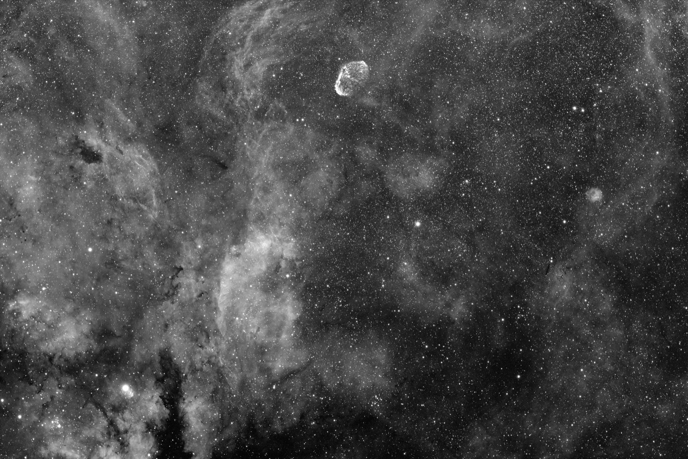
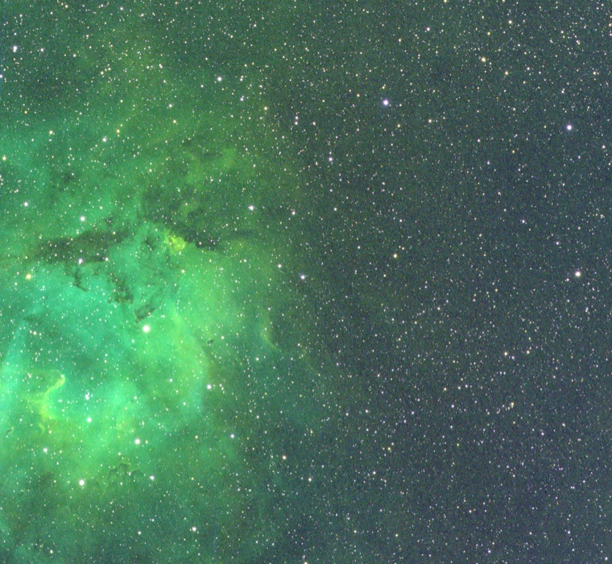
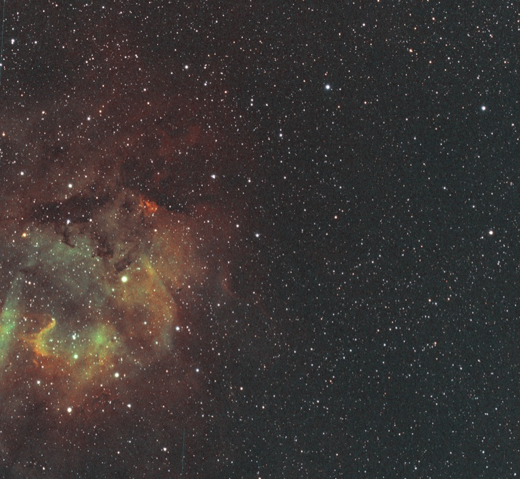

# Image processing

[Documentation](README.md) · [Performance](performance.md)

Keep calibration and stacking inputs linear. Apply background correction and
deconvolution before display stretching.

## Stacking

Stack linear FITS or XISF light frames, with optional bias, dark, and flat
masters. Seiza selects a reference frame, calibrates and registers the lights,
normalizes backgrounds, and integrates them with online delta-sigma rejection.
Add `--reintegrate` to reject trails and other transients using the completed
stack. Use `--drizzle 2` for a grid twice as fine when the data is undersampled
and dithered.

The defaults use quadratic registration, local background matching, inverse-noise
weighting, and Lanczos-3 resampling. Seiza aligns cropped frames and frames
rotated by a meridian flip to the reference grid.

Three-plane inputs produce linear RGB stacks. Seiza calibrates raw Bayer frames
before VNG demosaicing; MHC, bilinear, and Bayer drizzle are also available.
The output is unstretched `float32` FITS, or XISF when the output path ends in
`.xisf`. `--preview` writes a separate display image.

```text
seiza stack lights/*.fits --output stack.fits \
  --bias master-bias.fits --dark master-dark.fits --flat master-flat.fits \
  --reintegrate --preview stack.png --report stack-report.json
```



*Eight 300-second H-alpha frames stacked on the first frame's pixel grid. The
JPEG uses a display-only stretch; the stack itself remains linear `f32` FITS.*

Rust, Python, and C hosts use the incremental `LiveStacker` engine. Save a
`.seiza-stack` context to resume in another process with the registration and
rejection history intact. Rust hosts can use `SkyOrientationPlan` to reproject
a solved stack onto a north-up, east-left grid and obtain the updated FITS WCS.

See the [CLI stacking guide](../seiza-cli/README.md#image-stacking),
[Python stacking API](../seiza-py/README.md#image-stacking),
[stacking design](design/image-stacking.md), and [GPU controls](#gpu-controls).

## Light deconvolution (experimental)

Apply deconvolution to a calibrated linear stack after background correction
and before display stretching. Supply a stellar FWHM in pixels for the circular
Gaussian PSF. The defaults use four damped Richardson–Lucy iterations and blend
35% of the estimate into the input while preserving flux in each channel.
Missing pixels at registration borders remain masked.

```text
seiza deconvolve stack-bg.fits --output stack-light-dc.fits \
  --psf-fwhm 3.1 --iterations 4 --amount 0.35
```

Python provides `seiza.deconvolve(image, psf_fwhm=3.1)`; C hosts can call
`seiza_deconvolve_in_place`.

Debayer raw mosaics first. Inspect the result for noise amplification, rings,
and differences across the field: a spatially invariant Gaussian PSF cannot
model every star shape. See the [deconvolution API](../seiza-deconvolution/README.md),
[algorithm limits](design/deconvolution.md), and
[corpus trial with a ringing failure](benchmarks/2026-07-deconvolution-corpus.md).

## Background extraction

Correct a smooth gradient in a linear mono or RGB FITS/XISF image. Seiza fits
background samples and selects a polynomial degree using held-out validation.
Output remains linear `float32` and preserves the input WCS.

For an irregular gradient, choose a smoothed thin-plate radial-basis model
manually or allow automatic selection with `--auto-rbf`. Inspect the model
before applying it: a flexible surface can fit real extended emission.

```text
seiza background stack.fits --output corrected.fits \
  --model-output background.fits --diagnostics background.json

# Force a conservative plane for a simple additive gradient
seiza background stack.fits --output corrected.fits --model polynomial --degree 1

# Tune an irregular model and apply only 70% of its correction
seiza background stack.fits --output corrected.fits --model radial-basis \
  --rbf-smoothing 0.03 --strength 0.7

# Let held-out selection consider RBF after inspecting or masking the field
seiza background stack.fits --output corrected.fits --auto-rbf

# Multiplicative illumination correction
seiza background stack.fits --output corrected.fits --mode divide
```

The JSON diagnostics show each candidate's validation error and the selected
model. Use an exclusion mask to protect extended objects. Rust and JSON options
also accept normalized ellipse or polygon regions, including projected OpenNGC
outlines.

Rust, Python, and C APIs separate fitting from correction. Fitting stores compact
samples and coefficients; correction can run in place. A full-resolution model
image is allocated only when requested. See the
[background design](design/background-extraction.md) for sampling, correction
math, memory use, and limits.

## Color from mono stacks

Mono stacks can be turned into RGB/LRGB or narrowband quick looks
without changing the linear stack accumulator:

```text
seiza color lrgb --luminance l.fits --red r.fits --green g.fits --blue b.fits \
  --output lrgb.fits --preview lrgb.png

seiza color lrgb --luminance l.fits --red r.fits --green g.fits --blue b.fits \
  --luminance-mode super --output super-lrgb.fits --preview super-lrgb.png

seiza color narrowband --ha ha.fits --oiii oiii.fits --sii sii.fits \
  --palette sho --output sho.fits --preview sho.png

seiza color narrowband --ha ha.fits --oiii oiii.fits --sii sii.fits \
  --palette foraxx-sho --preview foraxx.png

seiza color rgb --red r.fits --green g.fits --blue b.fits \
  --crop inscribed --output rgb.fits
```

RGB, LRGB, additive super-LRGB (`L + R + G + B`), synthetic super-RGB
(`R + G + B`), SHO/HOO, direct three-filter permutations, and custom mixing
matrices produce linear samples. Foraxx-SHO and Foraxx-HOO use internally
stretched channels and mark the output as display-referred in FITS metadata.
See the [color-composition design](design/color-composition.md) for the equations.

The CLI registers filter stacks onto L, R, or H-alpha before composition.
Use `--no-register` when the masters already share a grid. To remove blank edges,
use `--crop bounds` for the bounding box of shared coverage or `--crop inscribed`
for the largest rectangle fully covered by every channel. Seiza updates `CRPIX`
for the crop, calculates channel scaling from the kept pixels, and reports any
channel whose coverage suggests a pointing error.

| Direct linear SHO | Foraxx-SHO quick look |
| --- | --- |
|  |  |

*Sh2-132 from twelve 300-second Askar107PHQ frames per H-alpha, OIII, and SII
channel. Seiza calibrated and stacked all 36 frames, handled the meridian-flip
orientation automatically, registered the three filter masters, and rendered
both previews from the same data. These images are cropped, downscaled
quick-look JPEGs; the composition outputs remain full-resolution `f32` FITS.*

## GPU controls

Stacking includes GPU acceleration by default through wgpu:
Metal on macOS, Vulkan on Linux, and Direct3D 12 or Vulkan on Windows. Supported
passes are defect screening, VNG debayering, detection preprocessing,
resampling, normalization application, live accumulation, and reintegration.

Small frames, unavailable adapters, buffer limits, or GPU errors use the CPU.
GPU single-precision rounding can differ from CPU output; see the
[GPU design and equivalence measurements](design/gpu-stacking.md). Decoding,
calibration, matching/transform fitting, normalization fitting, other demosaic
methods, and drizzle remain on the CPU.

```sh
seiza stack lights/*.fits --output stack.fits --no-gpu
seiza stack lights/*.fits --output stack.fits --cpu-pass debayer,detection
```

`--cpu-pass` accepts `defects`, `debayer`, `detection`, `resampling`,
`accumulator`, and `integration`. `--gpu-concurrency` bounds concurrent frame
calls (default 3); `--gpu-trace` prints per-call timings. Python uses
`GpuOptions` through `StackOptions`; the C ABI uses the `gpu` options object;
Rust uses `GpuOptions`. CPU-only builds can disable `seiza-stacking`'s default
features. Saved contexts retain their GPU options.

See [whole-stack performance](performance.md#stacking) and the
[Windows/NVIDIA measurements](benchmarks/2026-10-windows-nvidia-stacking.md).

## Display stretching

Stretching is explicit and separate from linear calibration/stacking output.
`seiza-stretch` separates image analysis, transfer-plan resolution, and
application, allowing previews and full-resolution processing to reuse a plan.
An ordered `StretchStack` stores float intermediates and each resolved plan.
Models include MTF/Auto-MTF, GHS, asinh, percentile-asinh, median-anchor, and
layered stretching.

See the [stretch API](../seiza-stretch/README.md),
[CLI JSON examples](../seiza-cli/README.md#parameterized-display-stretching), and
[display performance](performance.md#image-io-and-display).

## Photometric color calibration

Calibrate a solved linear RGB stack against Gaia DR3 stellar colors:

```sh
seiza color-calibrate stack-bg.fits --output stack-cc.fits --report colour.json \
  --display stack-cc.png
```

The command measures isolated unsaturated stars, fits instrumental color
against Gaia BP−RP, applies gains for the white reference (solar by default),
and neutralizes the background. Input needs FITS WCS or XISF astrometric
metadata. Use the [optional offline photometry catalog](catalogs.md#install),
a supplied CSV, or a cached ESA/GAVO field query.

`--display` adds a stretched image; inspect diagnostics because this mode can
write uncalibrated outputs when calibration cannot run. See the
[CLI reference](../seiza-cli/README.md#photometric-colour-calibration) and
[color-calibration design](design/color-calibration.md).

## Other operations

- [Calibration matching, frame grading, response fitting, and dust](../seiza-calibration/README.md)
- [Master construction](../seiza-stacking/README.md#calibration)
- [Parallax videos](../seiza-cli/README.md#parallax-fly-through-videos) and [scene API](../seiza-parallax/README.md)
- [Image-processing primitives](../seiza-imgproc/README.md)

See [benchmarks and methodology](performance.md) for recorded measurements.
