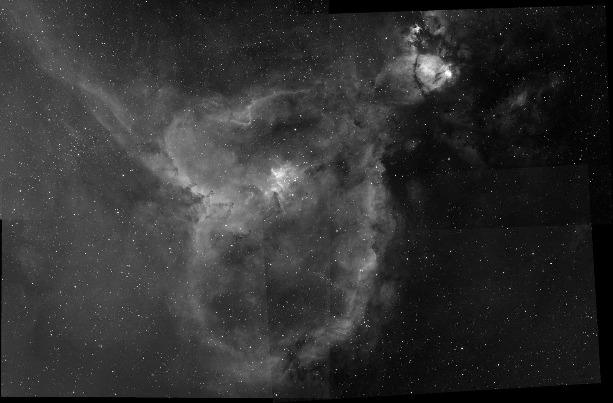
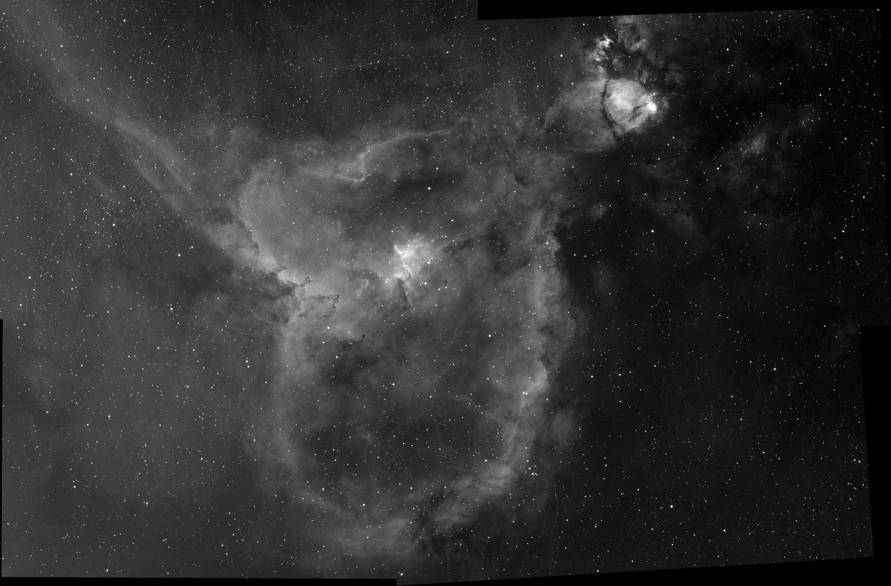
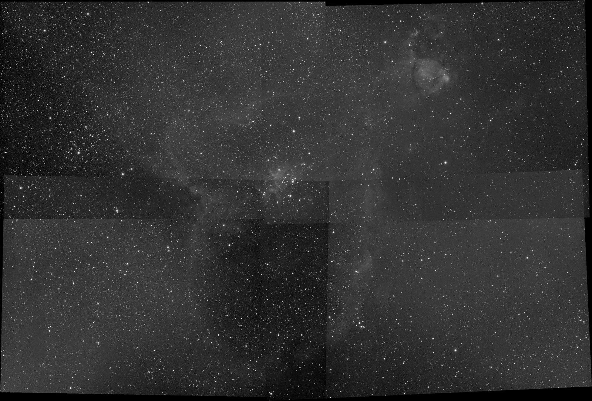
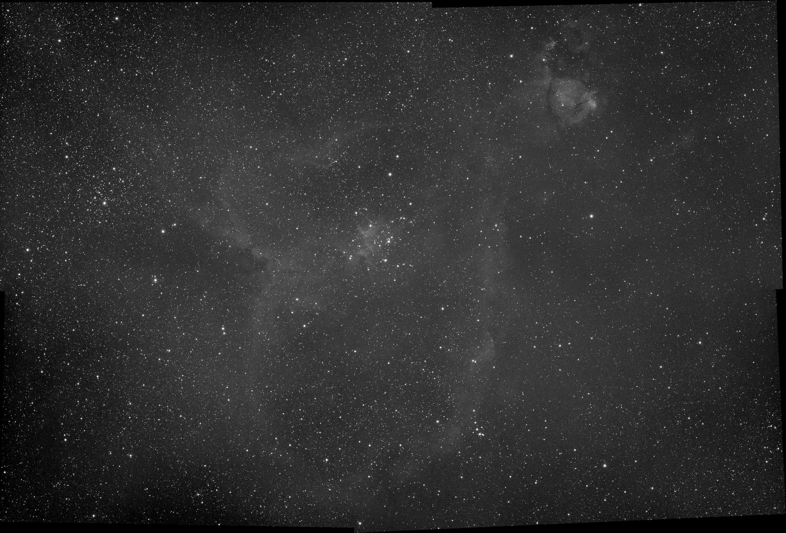

# Heart and Soul mosaic seam comparison

Four existing linear panel integrations per filter, binned 4x before planning
one canvas. These are existing panel masters, not a fresh rebuild of the raw
exposures. Both passes use the same registered inputs, equal frame weights
and three-pass rejection. The after pass enables Seiza's panel background
matcher, with matching sample support retained per channel. Each before/after
pair shares one display range and stretch,
resolved from the before image; the linear FITS data are unchanged by display.

The metric is the median absolute step at a changing panel footprint after
subtracting the local sky trend measured by inputs covering both sides. It
includes noise and registration residuals; it is a seam diagnostic, not a
photometric calibration or absolute background measurement.

| Filter | Before (ADU) | After (ADU) | Reduction |
|---|---:|---:|---:|
| R | 0.723 | 0.332 | 54.1% |
| G | 0.741 | 0.423 | 42.9% |
| B | 0.519 | 0.399 | 23.1% |
| HA | 1.061 | 0.357 | 66.4% |
| OIII | 0.430 | 0.346 | 19.5% |
| SII | 0.328 | 0.276 | 15.8% |

H-alpha:

| Before | After |
|---|---|
|  |  |

Red:

| Before | After |
|---|---|
|  |  |

The full PNG comparisons and reports for all six filters are in the matching
Dropbox example folder. Reports record dimensions, binning, the locked display
transfer, per-panel residuals and stacking output version 0.51.0. The source
panel masters represent 1,243 accepted exposures across R/G/B/Ha/OIII/SII;
H-alpha has 163 exposures, RGB 240 per channel, OIII and SII 180 each.

Reproduce with the opt-in `mosaic_backgrounds_real` integration test. Set
`SEIZA_MOSAIC_PANELS` to a JSON array of four source paths and
`SEIZA_MOSAIC_OUTPUT` to an output directory:

```sh
cargo test -p seiza-stacking --test mosaic_backgrounds_real -- --ignored --nocapture
```

The default binning is 4; `SEIZA_MOSAIC_BIN=1` uses native resolution.
