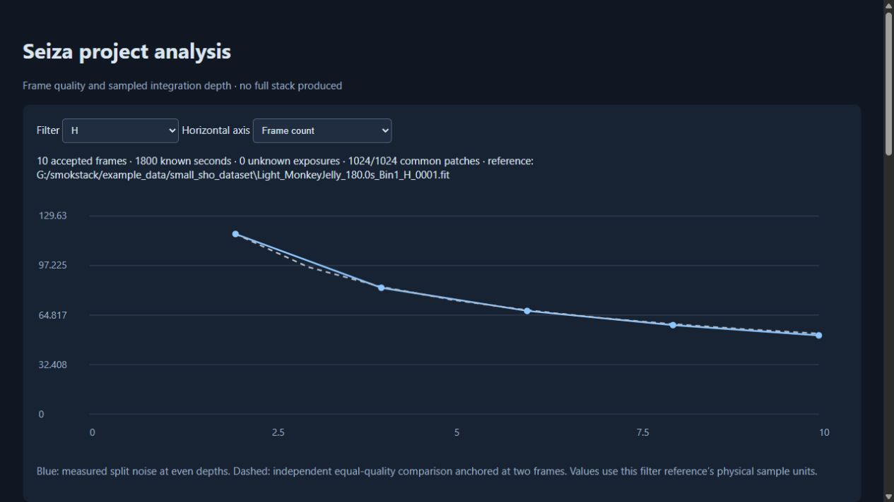
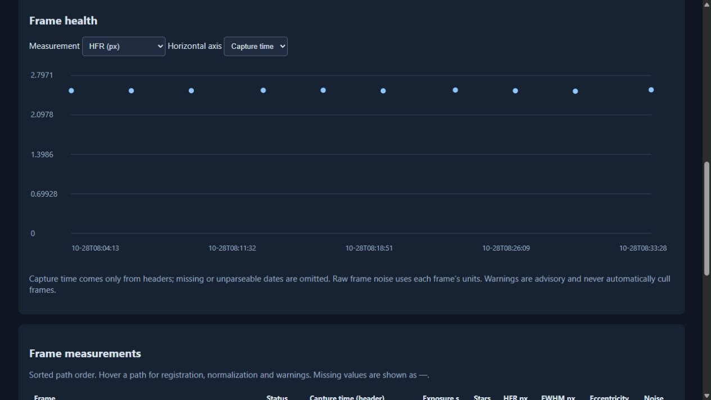

# seiza-analysis

Project diagnostics without producing a full stack. The CLI, C ABI and Python
call this same engine. The initial scope is monochrome, non-Bayer FITS/XISF.

```rust,no_run
let report = seiza_analysis::analyze(
    &["lights".into()], &seiza_analysis::AnalysisOptions::default(),
)?;
let json = serde_json::to_string_pretty(&report)?;
let html = seiza_analysis::render_html(&report)?;
# Ok::<(), Box<dyn std::error::Error>>(())
```

## Inputs and ordering

Inputs are files, nonrecursive directories, or UTF-8 `.txt` lists. Blank lines
and lines beginning with `#` are ignored. Relative list entries resolve beside
the list. Supported extensions are those of `seiza-image-io`, including `.xish`.
Paths sort lexically and deduplicate by `seiza-stacking::path_identity` (resolved
path identity, not inode identity). `max_frames` limits that list **before**
header-based `filter` selection. Filtering and grouping ignore case. Missing
filters form an explicitly warned unknown group; passbands are never inferred.

Each group uses its first readable frame with sufficient registration stars
as its reference. Unreadable, unsupported, wrong-sized and unregistrable frames
remain in the report with errors. Excluded filter frames also remain. A report
can contain no accepted frames; library callers must inspect `groups`/statuses.
The CLI writes that report but returns a failure exit status.

## Measurements and physical meaning

HocusFocus measurements with Gaussian PSF fits supply star count, HFR, FWHM and
eccentricity. Registration uses Seiza's default stellar similarity model on the
CPU, including its matching and drift gates. The reference's identity placement
is not presented as a measured zero residual. Frame noise uses the stacker's
second-difference estimator in native physical units.

Photometric gain is the median flux ratio of at least five unique matched,
unsaturated measured stars within two reference pixels. Flux is converted from
the measurement detector's u16 working scale back to physical units, including
for normalized floating-point images. Without five matches, exposure-ratio gain
(or unity if exposures are unknown) is explicitly marked as a fallback; it
cannot measure transparency. A median additive pedestal matches overlapping
samples. No spatial background model, calibration or defect repair is applied.

Deterministic nonoverlapping 16×16 patches at two-pixel pitch cover the central
80% of the reference. `samples` defaults to 262144, accepts 8192–2097152, rounds
down to whole patches, and is limited by image size. Inverse registration maps
reference sites to the nearest source detector pixel. Nonfinite, out-of-bounds,
duplicate sites within a patch, and samples at/above an explicit `SATURATE`
header invalidate the whole patch. Without that header, saturation masking is
unavailable and reported. Finite hot/dead pixels are not automatically repaired.

Compact f32 samples are spooled to temporary files, then replayed using only
patches valid in **every** accepted frame in their filter. This fixes the
footprint across all depths and bounds memory independently of frame count.
Disk use is approximately `4 × actual_samples × accepted_frames` bytes, across
all groups. Temporary files are automatically removed, including on errors.
No persistent cache or full intermediate resampled image is created.

At even N, each common patch measures `1.4826 × MAD((sum_odd − sum_even)/N)`.
The median of patch sigmas estimates noise of the equal-weight mean. At least
32 common patches are required; odd depths have no balanced split measurement.
The ideal comparison follows `sqrt(2/N)` anchored at N=2. Known positive exposure
times are summed separately from a count of unknown exposures. Capture times
come from headers through `seiza-image-io`, including native XISF metadata;
missing times are never replaced with filesystem timestamps.

A descriptive log-log noise trend uses geometric even-depth checkpoints in the
last fourfold window. At least five spanning a factor of two are required.
A conditional doubling estimate is supplied only for a negative exponent no
steeper than −1 and R² ≥ 0.8. It assumes the observed trend persists; it is not a
forecast. Correlated cumulative observations make R² descriptive, not confidence.

Shared scene structure **and shared systematic errors** cancel in split noise.
Seeing, registration and illumination changes can remain. Robust MAD describes
the distribution core rather than total outlier energy. This diagnostic does
not reproduce production weighting, interpolation, calibration or rejection.
Advisory HFR/star-count/noise warnings never automatically exclude a frame.


Per-filter baselines include `median_star_count`, `median_hfr`, `median_fwhm`,
`median_eccentricity`, `median_noise`, `median_background`, and `median_star_snr`.
These are medians of finite, available per-frame values among accepted frames
only, including groups of one or two frames; unavailable values are null.
Noise and background use native frame units, so their raw medians require
consistent input units. `median_normalized_noise` instead summarizes `noise *
gain` in reference units and is the baseline used by the noise advisory.
HFR and star-count advisories use the emitted group medians too.

Each frame's `median_star_snr` is the median unsaturated measured star's
`(peak - local background) / detector noise`, using HocusFocus's existing
working-scale noise estimate. It is dimensionless peak SNR, not integrated-flux
SNR, the frame-noise estimator, or stack SNR. Detection thresholds and changing
star populations affect it; compare it alongside star count, shape and matching.
Group shape baselines support caller-owned guiding/focus outlier thresholds;
they do not classify causes or automatically reject frames. New optional fields
can be absent when rendering older schema-1 reports.

## Reports and hosts

JSON carries `schema_version = 1` and `algorithm_version = 1`; changes to
measurement semantics must increment the latter. Top-level keys are `options`,
`frames`, `groups`, and `warnings`, in addition to the version fields. Frame
statuses are `accepted`, `rejected`, or `excluded`. Null means unavailable,
not zero. A group's `curve[].frame_index` indexes the top-level frame list.
Each group includes reference, footprint counts, accepted count, known seconds,
unknown-exposure count, curve, optional noise trend and warnings.

HTML embeds all data, CSS and JavaScript and uses no network or external assets.
It has filter selection, frame-count/integration axes, capture-time health plots,
hover details, errors and measurement caveats. Metadata is inserted as text and
embedded JSON escapes HTML delimiters. It can be opened directly or shared.

C: `seiza_analyze_project_json` accepts `inputs`, `samples`, `filter`, `maxFrames`;
the result uses camelCase keys. `seiza_analysis_html` renders that result.
Both strings are freed with `seiza_string_free`. Python: `analyze_project`
returns the core snake_case dictionary; `analysis_html` renders it.

The sampled balanced-difference approach follows Smokstak's project analysis.
This is a Seiza implementation built on its own readers, detectors and registrar;
it does not claim identical outputs or Smokstak's persistent cache and review UI.

## Real-data example: small SHO dataset

The MonkeyJelly sample (IC 443 / Sh2-249, ASI2600MM Pro, 6248×4176) contains
10×180-second frames in each of H, O and S. All 30 were accepted, each group
retained all 1024 candidate patches, and all 27 non-reference frames used
stellar-flux normalization. No full stack was produced.

| Filter | Accepted | Known exposure | Noise at N=2 | Noise at N=10 | N=10 / ideal |
|---|---:|---:|---:|---:|---:|
| H | 10 | 1800 s | 117.85 | 51.54 | 0.978 |
| O | 10 | 1800 s | 92.73 | 42.52 | 1.025 |
| S | 10 | 1800 s | 174.85 | 77.83 | 0.995 |

Noise values use each filter reference's physical units; compare depths within
a filter, not absolute values across filters. Ten frames provide too few
geometric checkpoints for a fitted trend, so the conditional improvement
estimate is correctly absent. The source headers do not declare `SATURATE`,
which the report flags rather than inventing a detector saturation threshold.




