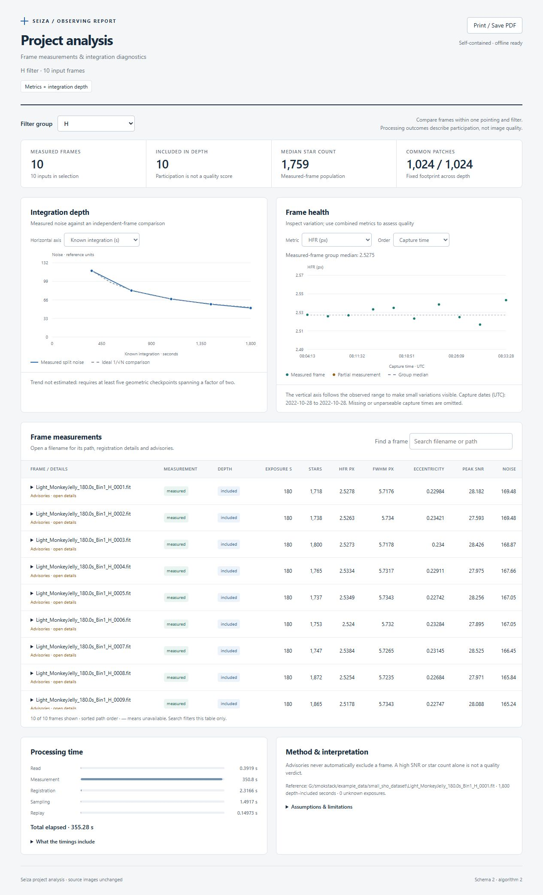
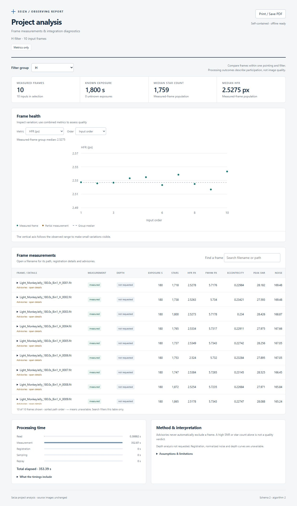

# seiza-analysis

Project diagnostics without producing a full stack. The CLI, C ABI and Python
call this same engine. Mono, raw Bayer and planar RGB FITS/XISF are supported.

```rust,no_run
let report = seiza_analysis::analyze(
    &["lights".into()], &seiza_analysis::AnalysisOptions::default(),
)?;
let json = serde_json::to_string_pretty(&report)?;
let html = seiza_analysis::render_html(&report)?;
# Ok::<(), Box<dyn std::error::Error>>(())
```

## Inputs and ordering

Inputs are files, nonrecursive directories, or UTF-8 `.txt` lists. Blank lines
and lines beginning with `#` are ignored. Relative list entries resolve beside
the list. Supported extensions are those of `seiza-image-io`, including `.xish`.
Paths sort lexically and deduplicate by `seiza-stacking::path_identity` (resolved
path identity, not inode identity). `max_frames` limits that list **before**
header-based `filter` selection. Filtering and grouping ignore case. Missing
filters form an explicitly warned unknown group; passbands are never inferred.

In full mode, each group uses its first readable frame with sufficient registration stars
as its reference. Unreadable, unsupported, wrong-sized and unregistrable frames
remain in the report with errors. Excluded filter frames also remain. Quality measurements survive failed registration or depth admission. A report
can contain no measured frames; library callers must inspect `groups` and
measurement outcomes. The CLI writes that report but returns a failure exit
status only when no frames were measured. Missing depth curves are diagnostic
outcomes, not a command failure or quality verdict.

## Metrics-only mode and comparison groups

`seiza analyze panel-1.txt --metrics-only` (Python `metrics_only=True`, C JSON
`metricsOnly: true`) performs reading, quality detection/PSF fits and native
noise/background measurement. It skips registration, matched photometry,
patch gathering, sample spooling and replay. Full analysis remains the default.
The same input produces identical per-frame quality measurements in both modes.
Registration fields, gain/offset, normalized noise and depth curves are unavailable
in metrics-only mode. `samples` retains its normal validation but is not used.

Use **one panel/pointing per input list or invocation**, then compare within each
filter. No automatic pointing discovery is attempted. Different fields can have
different star populations, even without registration. SNR, star count or any
single metric is not a quality ranking; use combined evidence and caller-owned
thresholds. SNR uses detector saturation screening, not a guaranteed physical
full-well threshold when saturation metadata is absent.

## Measurements and physical meaning

HocusFocus measurements with Gaussian PSF fits supply star count, HFR, FWHM and
eccentricity. Registration uses Seiza's default stellar similarity model on the
CPU, including its matching and drift gates. The reference's identity placement
is not presented as a measured zero residual. Frame noise uses the stacker's
second-difference estimator in native physical units.

Photometric gain is the median flux ratio of at least five unique matched,
unsaturated measured stars within two reference pixels. Flux is converted from
the measurement detector's u16 working scale back to physical units, including
for normalized floating-point images. Without five matches, exposure-ratio gain
(or unity if exposures are unknown) is explicitly marked as a fallback; it
cannot measure transparency. A median additive pedestal matches overlapping
samples. No spatial background model, calibration or defect repair is applied.

Deterministic nonoverlapping 16×16 patches at two-pixel pitch cover the central
80% of the reference. `samples` defaults to 262144, accepts 8192–2097152, rounds
down to whole patches, and is limited by image size. Inverse registration maps
reference sites to the nearest source detector pixel. Nonfinite, out-of-bounds,
duplicate sites within a patch, and samples at/above an explicit `SATURATE`
header invalidate the whole patch. Without that header, saturation masking is
unavailable and reported. Finite hot/dead pixels are not automatically repaired.

Compact f32 samples are spooled to temporary files, then replayed using only
patches valid in **every** depth-included frame in their filter. This fixes the
footprint across all depths and bounds memory independently of frame count.
Disk use is approximately `4 × actual_samples × depth_frames` bytes, across
all groups. Temporary files are automatically removed, including on errors.
No persistent cache or full intermediate resampled image is created.

At even N, each common patch measures `1.4826 × MAD((sum_odd − sum_even)/N)`.
The median of patch sigmas estimates noise of the equal-weight mean. At least
32 common patches are required; odd depths have no balanced split measurement.
The ideal comparison follows `sqrt(2/N)` anchored at N=2. Known positive exposure
times are summed separately from a count of unknown exposures. Capture times
come from headers through `seiza-image-io`, including native XISF metadata;
missing times are never replaced with filesystem timestamps.

A descriptive log-log noise trend uses geometric even-depth checkpoints in the
last fourfold window. At least five spanning a factor of two are required.
A conditional doubling estimate is supplied only for a negative exponent no
steeper than −1 and R² ≥ 0.8. It assumes the observed trend persists; it is not a
forecast. Correlated cumulative observations make R² descriptive, not confidence.

Shared scene structure **and shared systematic errors** cancel in split noise.
Seeing, registration and illumination changes can remain. Robust MAD describes
the distribution core rather than total outlier energy. This diagnostic does
not reproduce production weighting, interpolation, calibration or rejection.
Advisory HFR/star-count/noise warnings never automatically exclude a frame.


Per-filter baselines include `median_star_count`, `median_hfr`, `median_fwhm`,
`median_eccentricity`, `median_noise`, `median_background`, and `median_star_snr`.
These are medians of finite, available per-frame values among successfully measured frames
only, independently of depth admission, including groups of one or two frames; unavailable values are null.
Noise and background use native frame units, so their raw medians require
consistent input units. `median_normalized_noise` instead summarizes `noise *
gain` in reference units and is the baseline used by the noise advisory.
HFR and star-count advisories use the emitted group medians too.

Each frame's `median_star_snr` is the median unsaturated measured star's
`(peak - local background) / detector noise`, using HocusFocus's existing
working-scale noise estimate. It is dimensionless peak SNR, not integrated-flux
SNR, the frame-noise estimator, or stack SNR. Detection thresholds and changing
star populations affect it; compare it alongside star count, shape and matching.
Group shape baselines support caller-owned guiding/focus outlier thresholds;
they do not classify causes or automatically reject frames. Older schema-1 reports remain renderable.

## Reports and hosts

Schema 2 introduced `schema_version = 2` and `algorithm_version = 2`. Version 2
separates processing outcomes and changes the quality-baseline population;
the full-mode depth calculation itself is unchanged. Top-level keys are
`options`, `frames`, `groups`, `timings`, `warnings`, and the version fields.

- `frames[].measurement_status`: `measured`, `failed`, or `excluded` by filter.
  `error` describes measurement failure.
- `frames[].depth_status`: `included`, `unavailable`, or `not_requested`.
  `depth_error` explains failure after successful measurement; if measurement
  failed or was excluded, inspect its outcome/error instead.
- Neither outcome is a quality verdict. Null means unavailable, not zero.
- Groups exist whenever a filter has measured frames, even without a usable
  reference. `measured_frames` counts that population; `depth_frames` counts
  frames contributing to depth; `reference` is null without a depth reference.
- Native quality medians include all measured frames with a finite value for
  that metric. Missing measurements are omitted, not replaced with zero.
  `normalized_noise_frames` counts finite `noise * gain` contributions to
  `median_normalized_noise`; this narrower population requires normalization.
- `integration_seconds`, `unknown_exposures`, footprint counts, curves and trend
  describe **depth-included frames**, so counts are zero and curves empty when
  depth was not requested. A curve's `frame_index` indexes the top-level frames.

`timings` reports aggregate wall-clock seconds: `read_seconds`,
`measurement_seconds`, `registration_seconds`, `sampling_seconds`,
`replay_seconds`, `total_seconds`. Measurement includes conversion, detection,
PSF fits and native noise/background; registration includes its separate star
detection and reference setup; sampling includes normalization and temporary
sample writes. Failed attempts count. Stage timings do not overlap; total also
includes discovery, group summaries and overhead, but excludes rendering/writing
reports. Skipped stages are exactly zero. These are measurements, not performance
promises; compare release builds on the same inputs and machine.

The renderer still accepts schema-1 reports, interprets their legacy statuses
as depth outcomes, labels their older baseline population, and does not invent
missing timings. New consumers should use schema 2's explicit fields rather than
schema 1's ambiguous `status` or `accepted_frames`.

HTML embeds all data, CSS and JavaScript and uses no network or external assets.
It has filter selection, frame-count/integration axes, capture-time health plots,
a searchable frame ledger with keyboard-accessible details, errors and measurement
caveats. Summary cards, labeled charts and timing bars use a responsive layout;
print styles retain the selected filter and chart labels. A Dark mode toggle
remembers the preference when browser storage is available; printing always
uses the light palette. The toggle still works when storage is blocked. Download JSON saves the complete
embedded report, regardless of the current filter or table search, without
requiring a server or a separate JSON file. Metadata is inserted as text and
embedded JSON escapes HTML delimiters. It can be opened directly or shared.

C: `seiza_analyze_project_json` accepts `inputs`, `samples`, `filter`, `maxFrames`;
the result uses camelCase keys. `seiza_analysis_html` renders that result.
Both strings are freed with `seiza_string_free`. Python: `analyze_project`
returns the core snake_case dictionary; `analysis_html` renders it.

The sampled balanced-difference approach follows Smokstak's project analysis.
This is a Seiza implementation built on its own readers, detectors and registrar;
it does not claim identical outputs or Smokstak's persistent cache and review UI.

## Real-data example: small SHO dataset

The MonkeyJelly sample (IC 443 / Sh2-249, ASI2600MM Pro, 6248×4176) contains
10×180-second frames in each of H, O and S. All 30 were measured and included in depth analysis; each group
retained all 1024 candidate patches, and all 27 non-reference frames used
stellar-flux normalization. No full stack was produced.

| Filter | Depth-included | Known exposure | Noise at N=2 | Noise at N=10 | N=10 / ideal |
|---|---:|---:|---:|---:|---:|
| H | 10 | 1800 s | 117.85 | 51.54 | 0.978 |
| O | 10 | 1800 s | 92.73 | 42.52 | 1.025 |
| S | 10 | 1800 s | 174.85 | 77.83 | 0.995 |

Noise values use each filter reference's physical units; compare depths within
a filter, not absolute values across filters. Ten frames provide too few
geometric checkpoints for a fitted trend, so the conditional improvement
estimate is correctly absent. The source headers do not declare `SATURATE`,
which the report flags rather than inventing a detector saturation threshold.



## Metrics-only timing comparison

Ran both modes sequentially in a release build on the same local small SHO
MonkeyJelly dataset: 30 mono ASI2600MM Pro frames, 6248×4176, ten 180-second
exposures per filter. No concurrent test/build jobs ran during the comparison.
All 30 per-frame quality measurements and all native filter medians matched
exactly across modes. Full-mode curves also matched the earlier report exactly:
each filter retained 1024 common patches, with all 27 non-reference frames using
stellar-flux normalization.

| Stage (seconds) | Full | Metrics-only |
|---|---:|---:|
| Read | 0.39 | 0.39 |
| Quality measurement | 350.80 | 352.87 |
| Registration (including its detector) | 2.32 | 0.00 |
| Normalization / sampling / temporary writes | 1.49 | 0.00 |
| Replay | 0.15 | 0.00 |
| Total | 355.28 | 353.39 |

This single paired run shows essentially unchanged runtime: quality measurement
accounts for about 99% of the full run. Metrics-only removes depth work and its
eligibility constraints; it does **not** promise a dramatic speedup. Stage
measurements include detection/PSF fitting in the quality-measurement bucket,
not a separate pure-detector benchmark. Other datasets need their own timings.
The next performance investigation would target quality measurement, not assume
registration is the bottleneck. Source images were not modified.



## Completed-stack reports

`render_stack_html` renders a `seiza_stacking::PostStackReport` using the same
offline layout and shared styles as project analysis. Obtain that report with
`seiza_stacking::stack_report` or `drizzle_report`; capture
`LiveStacker::report_context` alongside the result for admitted inputs,
calibration assignments and admission settings.

The CLI exposes this as `seiza stack ... --report-html stack.html`.
The existing `--report stack.json` keeps its admission/provenance fields and
adds a `post_stack` section. Python and C expose matching report and rendering
APIs.

The screenshots show ten 180-second H-alpha exposures from the small SHO
dataset, reintegrated at 6248 × 4176. Rejection counts describe actual final
sample decisions; drizzle support is explicitly weighted drop area.


### Combining completed stacks

Report generation is optional. A collection contains independent stack results; it
never re-registers images or infers shared sky coverage. Labels are nonempty and
unique (ignoring case and surrounding whitespace), and input order determines the
initial selection. Missing filters and different output sizes are supported. RGB
components remain inside their own stack, distinct from collection labels.

The collection JSON is `{ "schema_version": 1, "title": "SHO", "stacks":
[{ "label": "S", "report": <PostStackReport> }, ...] }`.
The HTML embeds the validated collection for download, uses no network resources, and
supports keyboard controls, search, 100-row pagination and printing all stacks.
Rejected attempts appear when supplied in host provenance. Empty context remains
unknown, not zero exposure. Maps are bounded summaries; this is not a crop tool.

Rendering saved JSON does not reread images or compute checksums. Building the
original post-stack report scans existing support maps and copies ledger metadata;
CLI provenance additionally hashes input/output files. Reporting never enables
reintegration by itself.

Rust: `render_stack_collection_html(&StackReportCollection)`; entries are `NamedStackReport`.

Browser regression check (using the built Python wheel):
`python seiza-analysis/tests/browser_fixture.py check.html`, then open `check.html`.
Its first line reports PASS/FAIL for first-stack selection, 100-row pagination,
search beyond the first page, expansion, selection state, all-stack printing and
restoration of the interactive state. It uses 1,001 synthetic admitted inputs and
205 unsuccessful attempts per stack, without opening any images.


### Report detail and diagnostic charts

The lightweight renderer plots admission RMS, recorded drift, rotation,
normalization gain and each input's final rejected finite-sample percentage.
Missing measurements stay absent; online results without final counts show an
explicit empty state. These charts also work on previously saved reports.

`prepare_stack_report(report, level, inputs)` selects `none`, `cheap`, or `rich`.
None returns `None` before source I/O. Cheap retains the numerical summaries
and does no source-image reading. Rich runs the existing source-analysis engine
on explicit inputs and stores its result and stage timings under
`provenance.reporting.analysis`. The extra pass uses source pixels, not stack
calibration or final integrated pixels. Its charts are labeled separately.
C and Python expose the same operation. CLI rich mode additionally fingerprints
source, calibration and output files; cheap provenance uses metadata only.

The mode does not alter registration, integration, weighting, rejection or
`OUTPUT_VERSION`. A collection can contain cheap, rich and legacy reports.

See the [release-build report benchmarks](../docs/stack-report-benchmarks.md) for measured costs and reproduction instructions.


### OSC / RGB analysis (schema 3)

Analysis automatically recognizes mono, raw Bayer and three-plane RGB sources.
No extra option is needed, including for rich post-stack reports. The input list
is read once per source; measurement and registration run per component.
`max_frames` limits source paths; `samples` is the budget **per component**.

A schema-3 `frames` record represents one **source/component**, not necessarily
one file. CFA produces `R`, `G_red` (green on a red row), `G_blue` (green on a blue
row), and `B`; RGB produces `R`, `G`, `B`; mono produces `Mono`. Source-level read
failures or filter exclusions produce one record without sampling metadata.
Groups separate `(filter, image_kind, component)`, so CFA/RGB/mono never share
normalization or noise baselines. Do not sum exposure across color components.

Frame `sampling` records `image_kind`, `component`, `source_width`,
`source_height`, `spacing_pixels`, `offset_pixels`, declared `bayer_pattern`,
`storage_bayer_pattern` (row-order adjusted, before offsets), `bayer_offsets`,
and declared `row_order`. C JSON uses camelCase spellings of these same keys.
Native CFA sample `(x,y)` is at original stored-image pixel
`(2*x + offset_pixels[0], 2*y + offset_pixels[1])`. Each lattice retains every
native sample, including odd edges. No demosaicing, green averaging, white
balance or new calibration occurs. Unrecognized Bayer declarations and invalid
origin offsets are reported as failures rather than guessed as mono.

HFR, FWHM and registration RMS are in **original-image pixels** (CFA component
values multiplied by two); this does not recover details lost to sparse CFA
sampling. Undersampled stars can have biased shapes. Noise/background retain
native component units; depth noise uses that component's reference units.
Registration and photometric normalization are independent per component. A
component with too few stars/common patches can keep measurements while its
noise curve is unavailable. RGB retains existing demosaicing/resampling
correlations; it must not be interpreted as independent raw detector samples.

Both HTML renderers select filter/layout/component explicitly. Schema 1/2
reports remain renderable; new reports use schema/algorithm version 3.
Stacking and stretching numerical output versions do not change.
